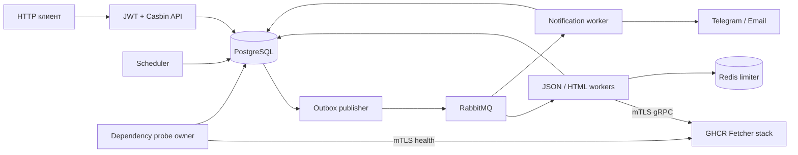

# Архитектура Monitoring-Service

Контракт HTTP — `openapi.json`; инфраструктура — `docker-compose.yml`.
Авторитетный gRPC-контракт, сервер и engines принадлежат [values-from-body-fetcher](https://github.com/wasss4bi/values-from-body-fetcher).

Контракт подключён напрямую через `github.com/wasss4bi/values-from-body-fetcher@v0.5.0`; локальных protobuf-копий нет. Monitoring-Service владеет пользователями/ролями, разрешёнными hostname и bootstrap policy, мониторами, сравнением, расписанием, retry, inbox/outbox и доставкой. Текущая роль читается из БД на каждом запросе; Casbin policy встроена в приложение. Owner проверяется по JWT и ID ресурса.

Fetcher не получает доступ к PostgreSQL, RabbitMQ, провайдерам уведомлений или ключу шифрования сессий. Он возвращает значения, provenance, ошибки и обновлённую анонимную сессию. Детали HTTP/DNS, JSON/HTML extraction, scalar cache, Node engines, Browserless, профили и Squid находятся в отдельном репозитории. Экземпляр stack отдельный для каждого проекта; все пять образов закреплены по версии и digest.

Job, session и finalization принадлежат монитору и защищены generation/token/lease. Общим остаётся endpoint URL, scalar cache и hostname permit. Полные документы не сохраняются. Отключённый контакт не получает уведомления; ошибка доставки не запускает повторный fetch. Переотправка после send-before-commit может дублировать уведомление.

При недоступном Fetcher durable состояние direct/browser и PostgreSQL probe lease координируют отложенные задания. Redis outage допускает локальный limiter fallback на каждый процесс. Подробные ограничения и проверенные сценарии — в [runbook](../fetcher/README.md).
